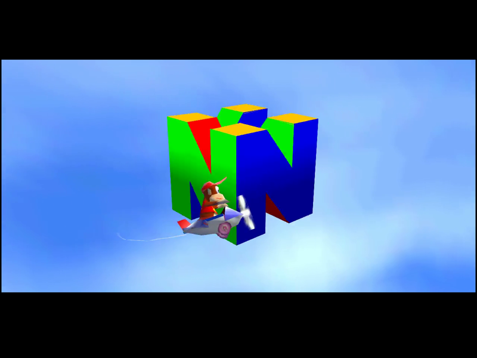
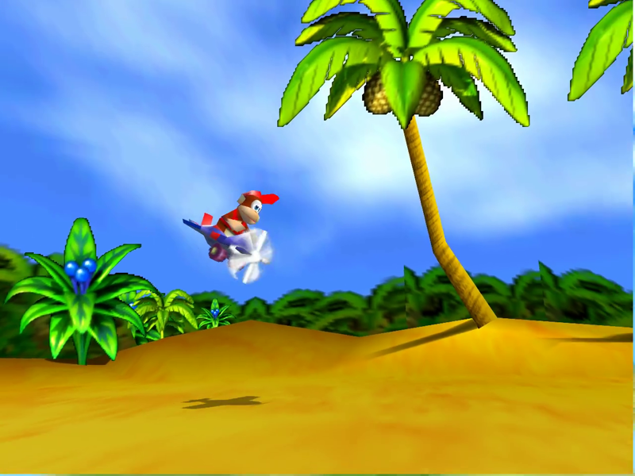
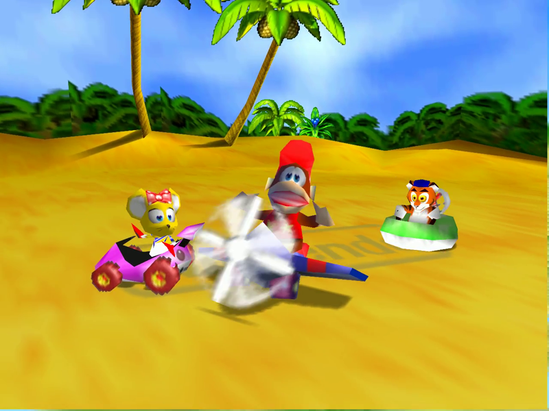
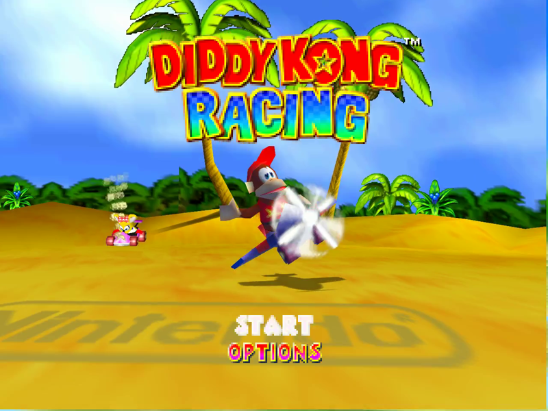
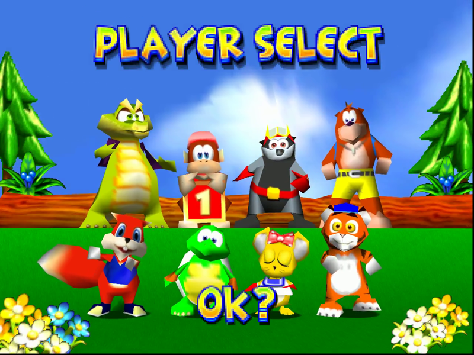
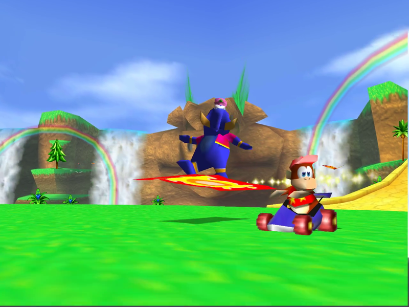

# Diddy Kong Racing Recompiled

A native Windows port of **Diddy Kong Racing** (N64, 1997), made by statically recompiling the
game's own code with [N64Recomp](https://github.com/N64Recomp/N64Recomp) and drawing it with
[RT64](https://github.com/rt64/rt64). You supply your own ROM; nothing from the game is in this
repo or downloaded by it.

## Status

**v0.2.0, alpha.** The game boots, plays its attract mode, and goes through the menus into
Adventure mode, with sound and at any resolution. Races beyond the first steps of Adventure haven't
been played through yet.

| | |
|---|---|
| Intro, attract mode, title | yes |
| Menus: character select, game select, initials | yes |
| Adventure mode: hub island, Taj | yes |
| Races, Tracks mode, multiplayer | not tested yet ([ROADMAP](ROADMAP.md)) |
| Graphics: RT64 (D3D12), any resolution, MSAA, widescreen option, texture packs | yes |
| Sound and music | yes |
| Saves (EEPROM: Adventure progress, times) | written to `saves\dkr.us.bin`; reloading progress not checked yet |
| Controller pak (ghosts) | no: the game is told no pak is plugged in |
| Controllers: keyboard and up to 4 pads, rebindable | yes |
| Platforms | Windows 10/11 x64 |

What it took, and why each fix sits where it does: [docs/game-fixes.md](docs/game-fixes.md).

## Screenshots

| | | |
|:-:|:-:|:-:|
|  |  |  |
| Intro | Attract mode | Attract mode |
|  |  |  |
| Title | Character select | Adventure: Taj |

All captured from the real build with `--headless --record` (see [Usage](#usage)), 2026-10-23.

## Getting Started

You need a Windows 10/11 x64 PC with a DirectX 12 GPU, about 8 GB of free disk, and your own
**USA v1.1** ROM of Diddy Kong Racing as a big-endian `.z64` file (SHA1
`6d96743d46f8c0cd0edb0ec5600b003c89b93755`, header CRC1 `E402430D`).

### Quick start

1. Download this repo ([Code → Download ZIP](https://github.com/sp00nznet/diddykongracing/archive/refs/heads/main.zip))
   and unzip it somewhere with a short path (such as `C:\Games\DKR`).
2. Put your ROM in that folder. Any file name works.
3. Double-click **`Setup.cmd`**. It checks for Git, CMake and Visual Studio's C++ build tools and
   asks before installing any that are missing (through winget). It then downloads the recompiler,
   runtime and renderer, recompiles your ROM and builds the game. The first run takes 30 to 60
   minutes; a rerun after a failure picks up where it stopped. If it stops, it says why in one
   sentence; the full log is `logs\setup.log`.
4. Double-click **`Diddy Kong Racing (recomp).cmd`**.

### Step by step

Each command runs in the repo folder, in a Developer PowerShell or any terminal.

1. Install [Git](https://git-scm.com/), [CMake 3.20+](https://cmake.org/), and Visual Studio 2022
   (or its Build Tools) with the **Desktop development with C++** workload. Open a new terminal
   afterwards so `PATH` is current.
2. Get the toolkits (sp00nznet's forks; [docs/building.md](docs/building.md) says why each branch):
   ```
   git -c core.longpaths=true clone --recurse-submodules -b fix/fallthrough-tail-call https://github.com/sp00nznet/N64Recomp deps\N64Recomp
   git -c core.longpaths=true clone --recurse-submodules -b feat/synchronous-rsp-tasks https://github.com/sp00nznet/N64ModernRuntime deps\N64ModernRuntime
   git -c core.longpaths=true clone --recurse-submodules -b feat/f3ddkr https://github.com/sp00nznet/rt64 deps\rt64
   ```
3. Build the recompilers:
   ```
   cmake -S deps\N64Recomp -B deps\N64Recomp\build -G "Visual Studio 17 2022" -A x64
   cmake --build deps\N64Recomp\build --config Release --target N64RecompCLI RSPRecomp
   ```
4. Copy your ROM into the repo folder as `baserom.us.z64`.
5. Recompile the game and its audio microcode:
   ```
   mkdir RecompiledFuncs
   deps\N64Recomp\build\Release\N64Recomp.exe dkr.recomp.toml
   deps\N64Recomp\build\Release\RSPRecomp.exe rsp\aspMain.toml
   ```
   The first prints `Function count: 1956` and ends with
   `[Info] Fallthrough in coss_2 to sins_2`; the second prints nothing. They write
   `RecompiledFuncs\` and `rsp\aspMain.cpp`.
6. Build:
   ```
   cmake -S . -B build -G "Visual Studio 17 2022" -A x64
   cmake --build build --config RelWithDebInfo --target DKRRecompiled --parallel
   ```
   The game is `build\RelWithDebInfo\DKRRecompiled.exe`.
7. Run it: `build\RelWithDebInfo\DKRRecompiled.exe`. The launcher asks for your ROM the first
   time (drop the `.z64` on the window), or finds `baserom.us.z64` next to the exe or in the
   working directory.

Usual trip-ups: a tool "not found" right after installing it means the terminal predates the
install, so open a new one. A build error about a missing file deep inside `deps\` usually means
the folder path is too long; move the repo somewhere shorter.

## Usage

The exe opens a launcher: **Play**, **Host a game** / **Join** (2-player netplay, untested with
DKR), and **Settings** (controls, graphics, sound). In the game, **Esc** or the controller's
**Back** button opens the menu. `--play` skips the launcher. F11 or Alt+Enter toggles fullscreen.

| N64 | Keyboard | Controller |
|---|---|---|
| Stick | W A S D / arrows | left stick |
| A (accelerate) | Enter or Space | A or right trigger |
| B (brake) | Left Shift | X |
| Z (use item) | Z | left trigger |
| R (hop, power-slide) / L | E / Q | right / left shoulder |
| Start | P or Backspace | Start |
| C buttons | numpad 8 4 6 2 | right stick, Y / B |
| D-pad | I J K L | D-pad |

Settings live in `dkr.json` in the working directory (written on first run): resolution, MSAA,
widescreen (`aspectRatio: Expand`), refresh rate, texture packs from `texture-packs\`, volume,
deadzone, per-player devices and bindings.

For testing and debugging, the exe takes `--headless` (the window sits off every monitor and is
still rendered), `--record out.mp4` (30 fps of the window piped to `ffmpeg`, which must be on
`PATH`), and these environment variables:

| Variable | Does |
|---|---|
| `DKR_QUIT_AFTER=60` | quits after that many seconds |
| `DKR_SHOT=10:a.bmp,30:b.bmp` | saves the window to those files at those times (seconds) |
| `DKR_AUTOPRESS=4:1000,7:8000` | holds N64 buttons (hex: `1000` Start, `8000` A, `4000` B, `2000` Z, `0010` R) for 0.25 s at those times |
| `DKR_AUDIODUMP=out.raw` | also writes the sound as raw 16-bit stereo |
| `DKR_STACKDUMP=20` | prints every thread's stack at that time, for hangs |
| `DKR_PEEK=0x801217E0,...` | prints those RDRAM words with a stack dump or crash |
| `DKR_WATCH=0x80121A54@5` | after 5 s, traps the first write to that RDRAM word and prints who did it |
| `DKR_DISPLAY=1` | opens on that monitor |

A run that goes from boot to the Adventure hub and records it:

```
set DKR_AUTOPRESS=4:1000,7:1000,10:8000,13:8000,16:8000,19:8000,22:1000,25:1000,28:8000,31:8000,34:8000,37:1000,39:8000
set DKR_QUIT_AFTER=90
build\RelWithDebInfo\DKRRecompiled.exe --headless --record run.mp4
```

## Building from source

The step-by-step route above is the build. [docs/building.md](docs/building.md) covers the
toolkit branches, what each step produces, the symbol file and where it comes from, and using your
own toolkit checkouts. [docs/architecture.md](docs/architecture.md) explains how the pieces fit;
[docs/game-fixes.md](docs/game-fixes.md) lists every DKR-specific fix and why.

This is an [N64Recomp](https://github.com/N64Recomp/N64Recomp) project in sp00nznet's recomp
house style, alongside [Racer](https://github.com/sp00nznet/racer) and
[Rampage](https://github.com/sp00nznet/Rampage): the toolkit ships, the generated code never does,
and fixes found here go back to the toolkits as PRs. Function names and the microcode details come
from the [Diddy Kong Racing decompilation](https://github.com/DavidSM64/Diddy-Kong-Racing) (CC0).

Want to help? [CONTRIBUTING.md](CONTRIBUTING.md).

## License

This repo's own code is MIT, see [LICENSE](LICENSE). A built game links
[N64ModernRuntime](https://github.com/N64Recomp/N64ModernRuntime), which is GPL-3.0, so the exe as a
whole falls under GPL-3.0; N64Recomp and RT64 are MIT, SDL2 zlib. No builds are distributed: you
make your own from your own copy. Diddy Kong Racing is © Rare / Nintendo; none of the game's code
or data is here, and the code generated from your ROM stays on your machine.
